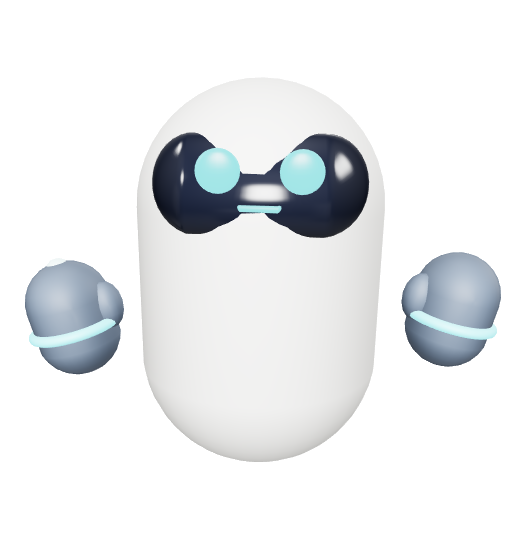

# Rabu Desktop Companion

Rabu is a Windows desktop companion that displays the animated
`rabu_companion/assets/rabu.glb` character directly on the desktop. The
character runs inside the PyQt application in a frameless, always-on-top,
transparent window. There is no separate browser tab, HTML viewer, card, or
painted background.



## Requirements

- Windows with desktop composition enabled
- Python 3.10 or newer
- Internet access when the animated character view starts, to load the
  pinned `<model-viewer>` library from unpkg

The GLB character is packaged locally with the application; it is not
downloaded from the internet.

## Install and run

Open PowerShell in the project directory and create a virtual environment:

```powershell
py -3.10 -m venv .venv
.\.venv\Scripts\Activate.ps1
python -m pip install -r requirements.txt
python -m rabu_companion
```

If PowerShell does not allow environment activation, run the commands
directly through the virtual environment:

```powershell
.\.venv\Scripts\python.exe -m pip install -r requirements.txt
.\.venv\Scripts\python.exe -m rabu_companion
```

The installed `rabu-companion` command also starts the application. Rabu
appears near the lower-right corner of the primary display.

## Use the companion

- **Click Rabu:** Rabu speaks a greeting and plays its `Wave` animation once,
  then returns to `Idle`.
- **Drag normally:** rotate the character.
- **Alt + drag:** move the companion window.
- **Right-click:** add a reminder or exit the application.
- **Add reminder:** enter a message and a 24-hour `HH:MM` time. If the time
  has passed today, it is scheduled for tomorrow.
- **When a reminder is due:** Rabu shows a speech bubble and dialog, speaks
  the reminder, and waves.

Rabu's reminder state selects its animation:

- **Idle:** no reminder is approaching.
- **Think:** the next reminder is due within 15 minutes.
- **Wave:** a reminder was completed within the last 10 minutes.

Reminders are checked once a second; emotion is refreshed every four seconds.

## Stop the application

Right-click Rabu and choose **Exit Rabu**. If you started it from a
PowerShell terminal, **Ctrl+C** in that terminal also stops the application.

## Project layout

```text
.
|-- rabu_companion/
|   |-- __init__.py              # Application package
|   |-- __main__.py              # `python -m rabu_companion` entry point
|   |-- character_view.py        # Transparent embedded 3D view and greeting bridge
|   |-- emotions.py              # Reminder-to-emotion rules
|   |-- reminders.py             # In-memory reminder data and queries
|   |-- speech.py                # Background text-to-speech
|   |-- window.py                # Frameless desktop UI and interactions
|   `-- assets/
|       |-- rabu.glb             # The companion's only character model
|       `-- rabu-preview.png     # Rendered image shown in this README
|-- tests/
|   `-- test_character_view.py
|-- pyproject.toml               # Package metadata and dependencies
|-- requirements.txt             # Editable install for local development
└-- README.md
```

## How the character is displayed

- `__main__.py` configures Qt high-DPI and shared OpenGL contexts before
  starting the window.
- `window.py` creates the frameless, always-on-top, translucent window and
  retains reminder controls, speech bubbles, and timer-driven emotion updates.
- `character_view.py` embeds a Qt WebEngine view in that window. It gives the
  browser an HTML page in memory (there is no viewer HTML file), loads
  `<model-viewer>` version 1.12.0 from unpkg, and embeds the local GLB into
  the page. The Qt WebChannel connects character clicks back to the greeting
  in the Python application.
- `reminders.py` stores reminders in memory and provides due, upcoming, and
  recently completed queries.
- `emotions.py` maps reminder state to calm, concerned, or happy.
- `speech.py` runs `pyttsx3` in a background thread.

The native window and embedded page are configured for a transparent
background. Windows desktop composition is responsible for showing the
desktop behind Rabu.

## Dependencies and limitations

- Runtime packages: PyQt5, PyQtWebEngine (including Qt WebChannel bindings),
  and pyttsx3.
- The embedded viewer needs internet access to load `<model-viewer>` from
  unpkg. The character model itself is local and included in the package.
- Reminders are one-time and kept in memory; they are lost when the app exits.
- There is no calendar sync, persistent reminder storage, voice input, or AI
  chat.

## Tests

Run the test suite from the project directory:

```powershell
.\.venv\Scripts\python.exe -m unittest discover -s tests -v
```

Tests check that the packaged GLB contains the animations used by Rabu and
that the embedded page is set up for transparency and desktop greetings.
